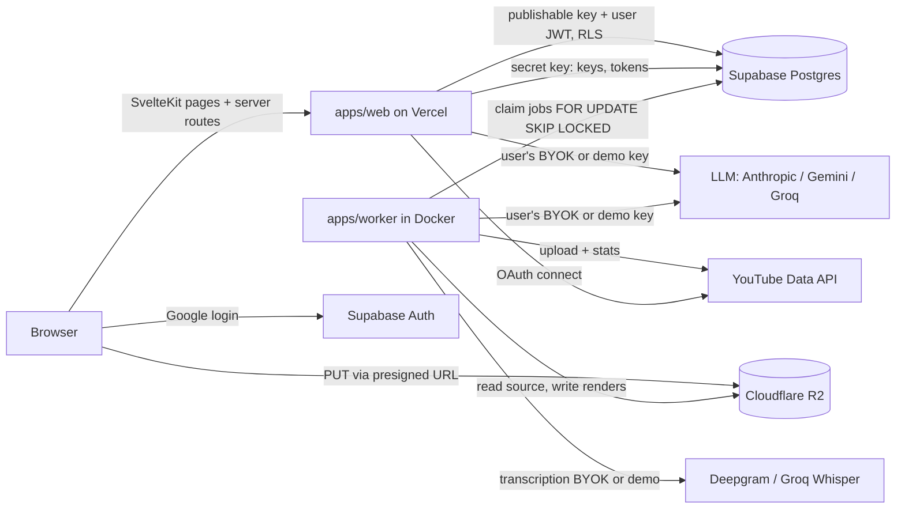

---
covers:
  - apps/web/src/lib
  - apps/web/components.json
  - apps/web/svelte.config.js
  - apps/worker/main.py
  - docker-compose.yml
last_updated: 2026-11-01
---
# Architecture

## Responsibilities
- **apps/web** (SvelteKit 2, adapter-vercel, runtime pinned to `nodejs24.x` in `svelte.config.js`;
  Vercel project `clip-studio`, production `https://clip-studio-pi.vercel.app`): UI, auth session, presigning uploads, BYOK save +
  validation, editor agent (server routes), enqueueing jobs/renders. Never touches video bytes.
- **apps/worker** (Python, Docker, FFmpeg): one loop that claims queue jobs, runs the pipeline,
  renders timelines, publishes scheduled posts, collects metric checkpoints.
- **packages/timeline-schema**: the contract between editor and renderer.
- **packages/llm-registry**: model registry + response fixtures shared by both LLM adapters
  (`docs/llm.md`).
- **Supabase**: Postgres (data + queue) and Google login. Hosted even in local dev.
- **R2**: all video. Browser uploads directly via presigned URLs.

## Web: Feature-Sliced Design inside `src/lib`
Layers (import only downward): `widgets → features → entities → shared`. Routes (`src/routes`)
compose widgets/features. `src/lib/server` is SvelteKit's server-only folder (`$lib/server`),
outside FSD layering: secrets, Supabase service client (`supabase-admin.ts`), crypto, keys,
R2 presign, dev login, `brand.ts` (profile save, logo presign, stated_rules), and `llm/` (the web LLM adapter, key resolution, AI guards; `docs/llm.md`).
Each layer has an `index.ts` with a `// Docs:` header; slices go in `src/lib/<layer>/<slice>/`.

Today's slices:
- `shared/ui/*`: shadcn-svelte components (generated, aliases in `components.json`) plus ours
  (page-header, empty-state, status-badge, timecode, data-table, topbar-actions, chips-input). See
  `docs/design/design-system.md`.
- `shared/lib/utils.ts` (`cn` + shadcn prop types), `shared/lib/is-typing.ts`, `shared/lib/hooks/`.
- `shared/config/`: `nav.ts` (one route list for sidebar, palette, breadcrumbs) and
  `shortcuts.ts` (every keyboard shortcut).
- `widgets/app-shell`: sidebar, top bar, command palette, shortcut sheet, key handler.
- `entities/api-key`: BYOK provider list, key status, `aiCapabilities`, `<RequiresAI>` gate.
  `features/api-keys`: Settings key row, provider select, AI preferences.
- `entities/brand`: brand profile zod, rule types, `buildMemoryContext`, `ConflictCard`.
  `features/brand-profile`: profile sections (onboarding + /brand). `features/brand-rules`: rule
  row, draft list, scope select (`docs/brand-memory.md`).
- `entities/job`: job/transcript types, upload limits, transitions. `features/upload-video`:
  dropzone + presigned upload. `widgets/job-queue`: queue list + details sheet (`docs/queue.md`).
- `entities/timeline`: timeline ops catalog, history, editor types. `widgets/editor`: the editor
  (`docs/timeline.md`).
- `entities/post`: post types, platforms, status badge, `canPost` actions.
  `features/platform-connections`: Settings YouTube connect. `features/publish-clip`: publish
  form. `widgets/post-calendar`: calendar month/table views + post details (`docs/publishing.md`).
- `shared/lib/form-action.ts` (`formAction()`: call a page's form action from JS).

Routes: `(authed)/(shell)/*` render inside `AppShell`; `(authed)/onboarding` is protected but
full-screen; `login` and `auth/*` are public. Auth flow: `docs/auth-and-keys.md`.

## Local dev
`pnpm dev` runs web against hosted Supabase/R2. `pnpm worker` runs the worker in Docker
(`docker-compose.yml`, only service). Env: `docs/env.md`.
