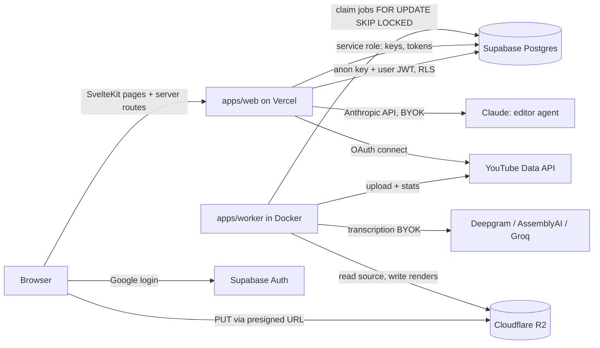

---
covers:
  - apps/web/src/lib
  - apps/web/svelte.config.js
  - apps/worker/main.py
  - docker-compose.yml
last_updated: 2026-10-31
---
# Architecture

## Responsibilities
- **apps/web** (SvelteKit 2, adapter-vercel): UI, auth session, presigning uploads, BYOK save +
  validation, editor agent (server routes), enqueueing jobs/renders. Never touches video bytes.
- **apps/worker** (Python, Docker, FFmpeg): one loop that claims queue jobs, runs the pipeline,
  renders timelines, publishes scheduled posts, collects metric checkpoints.
- **packages/timeline-schema**: the contract between editor and renderer.
- **Supabase**: Postgres (data + queue) and Google login. Hosted even in local dev.
- **R2**: all video. Browser uploads directly via presigned URLs.

## Web: Feature-Sliced Design inside `src/lib`
Layers (import only downward): `widgets → features → entities → shared`. Routes (`src/routes`)
compose widgets/features. `src/lib/server` is SvelteKit's server-only folder (`$lib/server`),
outside FSD layering: secrets, Supabase service client, crypto, R2 presign, agent.
Each layer has an `index.ts` with a `// Docs:` header; slices go in `src/lib/<layer>/<slice>/`.

## Local dev
`pnpm dev` runs web against hosted Supabase/R2. `pnpm worker` runs the worker in Docker
(`docker-compose.yml`, only service). Env: `docs/env.md`.
